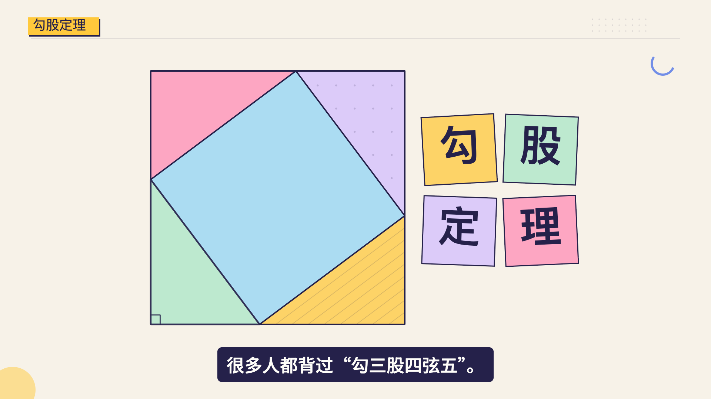
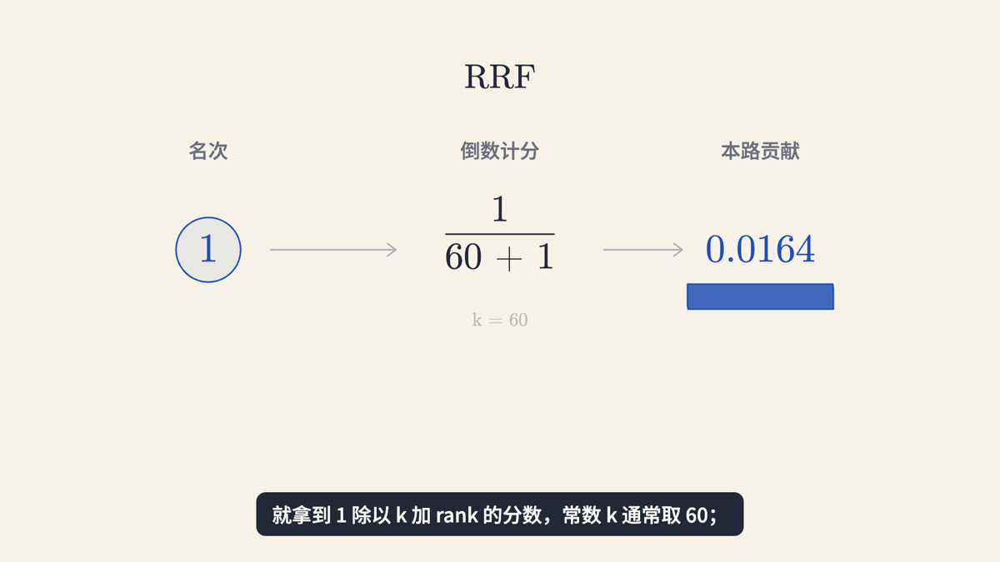
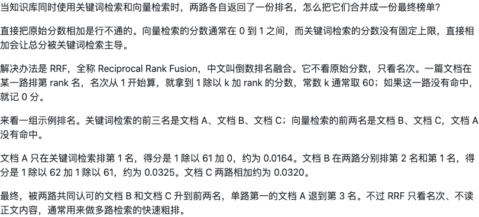
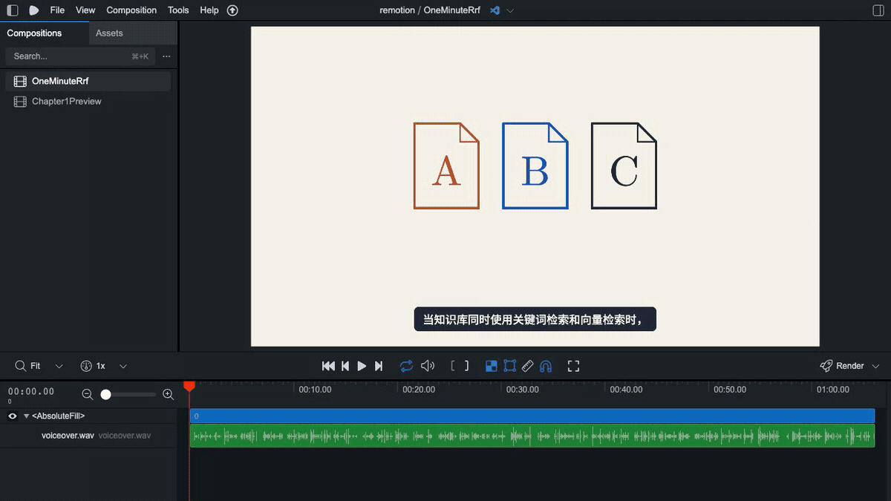
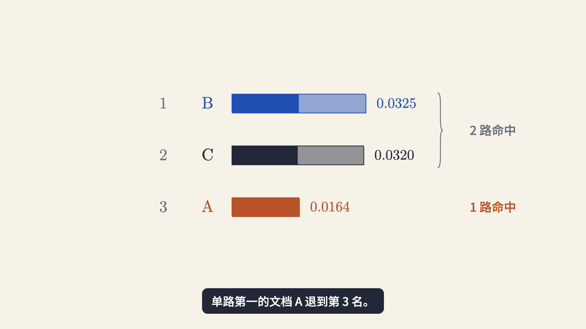
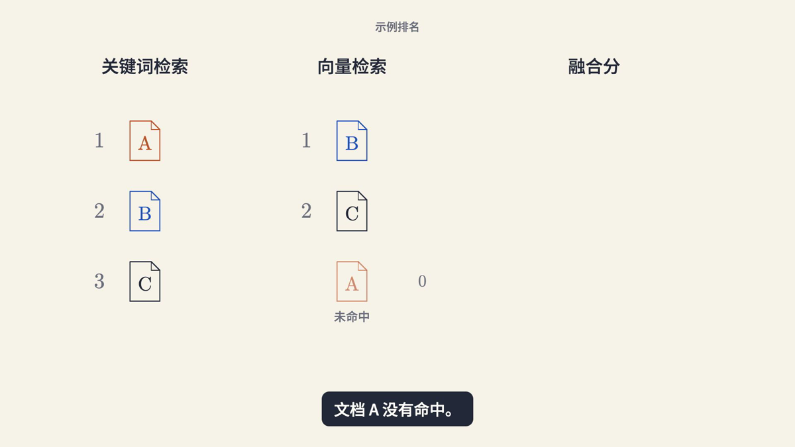

# one-minute-remotion

把一个知识点，做成一条 1 至 2 分钟的中文科普视频。支持勾股定理、牛顿第一定律、阿基米德原理、欧姆定律等数理化生知识，也支持 RRF、RAG、ReAct 等 AI 概念。

从文字稿到配音、分镜、概念动画、字幕和 MP4，按阶段推进。画面借鉴并实际接入 [huashu-art-motion](https://github.com/alchaincyf/huashu-art-motion) 的形变、描画、公式与相机模块，默认暖米几何，也可选择已经过实际项目打磨的孟菲斯画风。

**保留你的文稿，用你选定的声音。说“下一步”，就只做下一步；动画约30秒一章，看过确认后再做下一章。**

这里是独立 Skill 的开源主仓库：安装、制作规则、脚本与可导入的 ZIP 都从这里获取。[VibeScience](https://github.com/itwanger/vibe-science)提供配套的公开无声画面工程，不是使用本 Skill 的前置依赖。

## 新版能力与目录

- 写稿面向数理化生与 AI 知识，目标1至2分钟；默认120秒，现有60秒锁定目标继续保留。
- 配音先试听、分镜先确认；动画按约30秒逐章交付有声 Studio 预览，整片确认并明确要求导出后才出 MP4。
- 主题、工具、版本分开归档；动画库、字体和基础色板共用固定版本，各期的音频、时间轴与场景独立保存。
- 手机观看默认48px字幕，检查完整标签框、公式上标和转场；提供暖米与孟菲斯两套视觉规范。

```text
你的工作目录/
├── docs/src/ai/one-minute/                 文字稿
└── videos/one-minute/
    ├── pythagorean-theorem/codex/memphis/  主题 / 工具 / 版本
    │   ├── project.json、PROGRESS.md
    │   ├── audio/、build/、assets/
    │   ├── remotion/、preview/
    │   └── output/                        正式成片
    ├── ohms-law/workbuddy/reviewed/        另一主题，可记录接力工具
    ├── shared/                            固定版本动画库、字体、基础色板
    └── _archive/                          历史试作（可选）
```

工具来源不明时用 `unattributed`；接力项目记录各工具参与环节，保留一份工程。`script/one-minute/` 集合也支持相同结构；旧的独立工程可继续使用，不强制迁移。

## 画面案例：勾股定理

[孟菲斯案例](references/approved-memphis.md)和[暖米几何案例](references/approved-pythagorean.md)记录构图、拼图证明、手机字号与实际返修取舍。下面是公开无声工程的真实成帧，**不是已导出的有声成片**。



[文字稿范例](examples/pythagorean-theorem.md) · [视觉规范](references/visual-style.md) · [逐章审片流程](references/chapter-preview.md)


## 完整视频案例：RRF（早期60秒目标）

下面是这次 RRF 视频的真实输出：文档的两路贡献逐步合并，最终榜单连续换位。动态图截取原视频46.8–62.3秒，正常速度播放，无声。

[](https://github.com/itwanger/one-minute-remotion/releases/download/v0.1.1/rrf-demo.mp4)

**[观看 / 下载完整视频：66.13秒，1080p，含二哥旁白与完整字幕](https://github.com/itwanger/one-minute-remotion/releases/download/v0.1.1/rrf-demo.mp4)** · [原始文稿](examples/rrf.md) · [完整案例与分镜](docs/rrf-case.md)

我们的风格是**暖米色背景、蓝色主色、铁锈橙强调、深色正文**。同一份文档始终同名同色，让它沿路径移动、从轮廓变成贡献条，再合并和换位。公式、参数、数值贴着对应对象；画面展示机制，旁白和字幕负责解释。



原稿与声音完整保留，所以这条实际是 **66.13秒**，没有为了凑60秒删字或加速。这是从原有制作实践提炼出的案例；公开版安装后使用你自己的声音配置或音频，不会获得演示里的可调用音色。

## 一句话安装

把下面这句话发给支持 Skills 的 Agent：

> 请从 https://github.com/itwanger/one-minute-remotion 安装 one-minute-remotion Skill 到当前 Agent，读完 SKILL.md 后告诉我安装结果，先不要制作视频。

或者在终端执行一条命令，选择要安装到的 Agent：

```bash
npx skills add itwanger/one-minute-remotion -g
```

也可以指定 Claude Code 或 Codex：

```bash
npx skills add itwanger/one-minute-remotion -g -a claude-code -y
npx skills add itwanger/one-minute-remotion -g -a codex -y
```

安装命令使用 [Vercel Skills CLI](https://github.com/vercel-labs/skills)，需要 Node.js 22.20+。安装后按目标 Agent 的机制重新发现 Skill，必要时新开会话。命令只安装技能文件，不会自动开通 TTS、生成音频或安装视频依赖。

豆包工作或采用界面导入方式的 Agent：到 [Releases](https://github.com/itwanger/one-minute-remotion/releases/latest) 下载 `one-minute-remotion.zip`，在技能导入入口上传。DeepSeek Harness 等环境取决于其宿主是否支持标准 `SKILL.md`：支持目录加载时，将完整技能目录放入其实际配置的 skills 目录；没有该能力时可让 Agent 读取仓库使用，但这不等于原生安装。不要只复制 SKILL.md，脚本、引用文档和动画资源都需要保留。

## 示例：做一条 RRF 科普视频

**1. 先写文字稿**

```text
用 one-minute-remotion，为第一次接触混合检索的同学写一条一分钟 RRF 科普视频文字稿。
用关键词检索和向量检索的同一组文档举例，保存到 docs/src/ai/one-minute/rrf.md，先只写稿。
```

你也可以用 Gemini 或其他 Agent 写稿。本仓库提供 [RRF 文字稿示例](examples/rrf.md)，现成稿件会完整保留；它就是上方演示所用的完整文字，不保证恰好60秒。

**2. 已有稿件，就说下一步**

```text
文字稿已经保存到 docs/src/ai/one-minute/rrf.md，下一步。
```

Agent 会进入配音阶段。如果还没有声音配置，会先让你指定已有音色或音频；完成后交付完整音频供试听，然后停下。

**3. 逐步做完视频**

| 你当前的进度 | 再说“下一步”时做什么 | 交付后 |
| --- | --- | --- |
| 文字稿已保存 | 固定文字与声音，生成或导入配音，量时并核对 | 停下，让你试听 |
| 配音已试听确认 | 按实际配音设计分镜和约30秒审片章节 | 停下，让你看分镜 |
| 分镜已确认 | 只制作当前章，交付有声 Studio 预览 | 本章确认后才做下一章 |
| 全部章节已通过 | 交付整片有声 Studio 预览，检查衔接 | 停下，等待整片确认 |
| 整片已确认且明确要求导出 | 导出 MP4，核对文字、完整解码与音画同步 | 交付成片与项目 |

当前阶段有问题时，先修当前阶段。“下一步”不会绕过问题；未试听通过也不会被记录成“声音已认可”。只有你明确要求“一口气做完”，才连续执行授权范围内的阶段。

**4. 修改时直接指出画面问题**

```text
文档 A 在向量检索中未命中，但请保留 A 的文档图形和名称，弱化显示，并单独标注“未命中”。
右侧分组括号开口朝向 B、C，别把 A 包进去。保留文稿、声音和已认可的转场，只改这些画面。
```

## 从文稿到视频，这次实际做了什么

**① 文稿先固定。** 这份 [RRF 文稿](examples/rrf.md) 用同一组 A/B/C 文档贯穿：两路排名 → 名次计分 → 贡献相加 → 最终重排。下面是 GitHub 中原文的真实截图，原稿没有为视频删减。



**② 配音先试听，再做画面。** 沿用二哥已有音色和选定语速，完整音频实测66.130秒。先固定声音和真实时间轴，再按语音锚点设计动画；这一条共有26组短句字幕。演示里的旁白可以在完整视频中听到，音色配置与原始录音不随 Skill 分发。

**③ 分镜写清对象怎样变化。** 不按“一句话一张卡片”排版，而是让一个例子连续演进：

| 视频位置 | 画面怎样讲 |
| --- | --- |
| 00:00–00:16 | A/B/C 分到两路排名；不同尺度的原始分数展示直接相加的问题 |
| 00:16–00:32 | 引入 RRF；名次变为倒数贡献，参数靠近公式 |
| 00:32–00:56 | 同一组示例排名进入计算，A 单路命中，B/C 的两路贡献汇到各自行 |
| 00:56–01:06 | 保留名字与颜色，贡献条连续换位为 B、C、A，最后说明适用边界 |

**④ 在 Studio 里看真正的动态预览。** 下面是本次真实录制的 Remotion Studio 播放片段，能看到画面、字幕和时间线一起推进；录屏不含音频，完整旁白请播放上方 MP4。



**⑤ 导出完整视频，再核对细节。** 这份展示文件是同一次制作保存的完整 MP4，1920×1080、30fps、1984帧。文件全解码和多个有声窗口的同步检查通过；这些机械检查不能替代实际试听。最后的示例排序是 B≈0.0325、C≈0.0320、A≈0.0164。



像“向量检索未命中 A”这样的状态，仍保留 A 的文档轮廓和名称，旁边单独标注未命中与0贡献，不把它画成第三名。这些实际返修经验也已经写进 Skill。

<details>
<summary>查看“未命中仍保留对象身份”的画面</summary>



</details>

## 安装之后需要什么

写稿和分镜由当前 Agent 完成，不强制使用 Gemini，也不要求另外安装作者的其他 Skill。

真正制作视频需要本地命令执行能力、Node.js 22.20+、Python 3.10+、FFmpeg/ffprobe，以及可访问 Studio 的浏览器。包内提供固定版本的 Remotion 工程模板，Agent 会在你的项目目录安装 npm 依赖；首次渲染可能下载 Chromium。初始化脚本不主动调用云服务。

声音有两种接法：

- **自己的音频**：按意群导入 WAV/MP3，生成真实时间轴，不需要云端 TTS 凭证。
- **自己的 TTS 配置**：使用已有客户端生成音频后导入；包内也保留了兼容原火山单向 SSE 接口的可选适配器，需要自己可用的服务地址、资源、音色 ID 和环境变量凭证。

完整演示含二哥旁白供观看；技能运行资源不提供可调用的二哥音色配置、克隆模型、原始录音、头像或密钥。安装成功与配音服务可用是两件事。TTS 的费用、可用模型和调用权限由使用者自己的服务决定。命令和配置细节见 [制作流程](references/runtime.md)。

## 这个 Skill 会坚持什么

- 文稿完整，选定声音与语速保留。超过设定目标（默认120秒）只报告实测时长，不删稿、不建议删减、不截断或加速。
- 动画展示机制，主画面不重复字幕里的整句解释或同义问答。
- 相关元素成组对齐，公式、参数和结果有清楚的关系；异常状态仍保留对象身份。
- 分组括号朝向与范围正确，检查动画中间状态的遮挡和穿越。
- Studio 在后台启动，不让 Agent 等待一个不会结束的服务命令。截图只辅助检查，不能冒充动态预览。
- 不把教学示例伪装成模型实测，不把机械检查通过说成听感和教学效果已经通过。

## 仓库结构

```text
SKILL.md                         Agent 入口
references/                      写稿、动画、运行流程与来源
scripts/                         文字锁定、共享资源安装、Studio 后台启动
assets/huashu/                   固定版本的绘图库和字体，附原许可与哈希
assets/runtime/shared/           独立项目模板、音频与导出工具
assets/palette.json              默认色板及出处
assets/styles/                   孟菲斯基础色板
examples/                        RRF 与勾股定理文字稿范例
docs/rrf-case.md                  案例、分镜与实际截图/录屏
```

开发时运行 `python3 -m unittest discover -s tests -v`，打包运行 `python3 scripts/package_skill.py --output dist/one-minute-remotion.zip`。安装不会把作者现有的个人技能目录切换到这个仓库。维护者同步范围与发布检查见 [开源维护说明](docs/maintaining.md)。

## 来源与许可

本项目原创及从作者现有视频工具提取的部分采用 [MIT](LICENSE)。[huashu-art-motion](https://github.com/alchaincyf/huashu-art-motion) 的原文件、语法卡与许可证保留上游归属；字体沿用各自的 OFL 许可，详见 [第三方说明](THIRD_PARTY_NOTICES.md)。示范角色、作者肖像与私人声音不在分发范围内。

Remotion 属于单独的依赖，其使用条件按 [Remotion 官方许可](https://www.remotion.dev/license) 执行，本仓库的 MIT 许可不替代它。工具最初来自二哥的一分钟课堂科普视频实践，详见 [来源与取舍](references/sources.md)。
