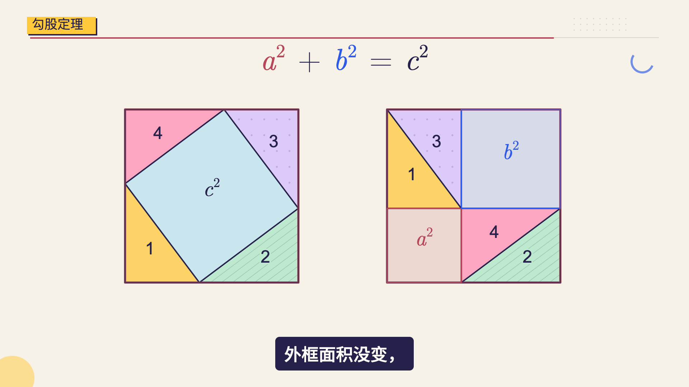
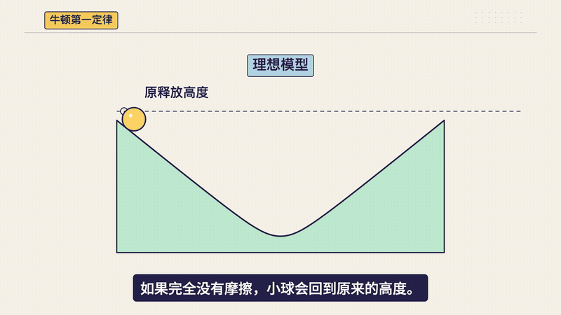
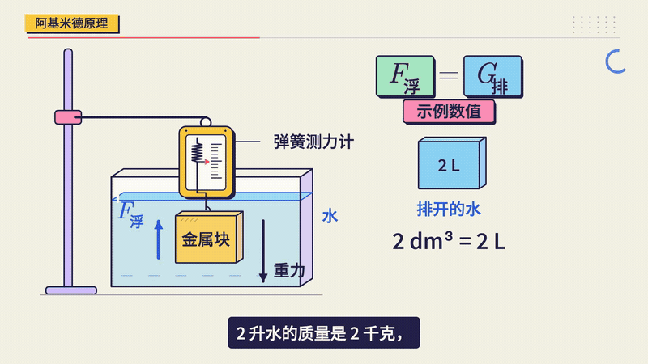
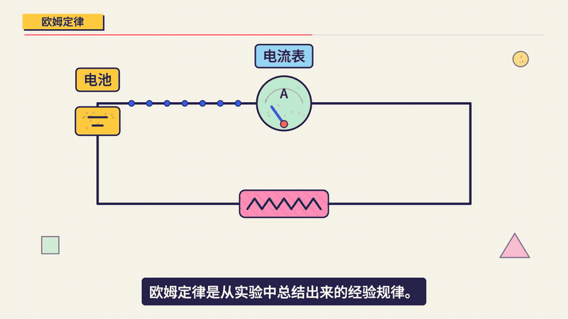
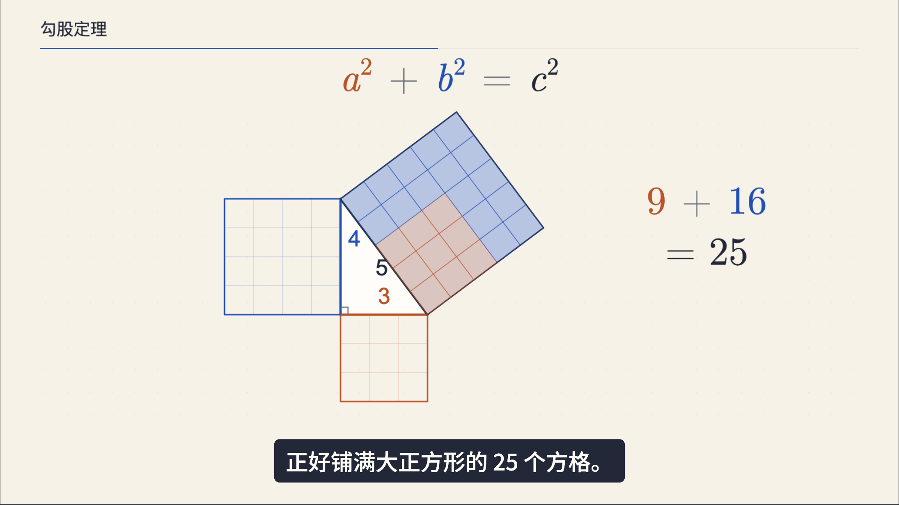
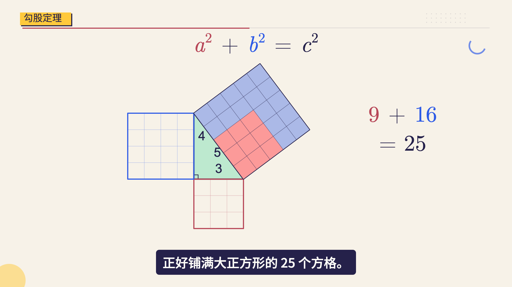
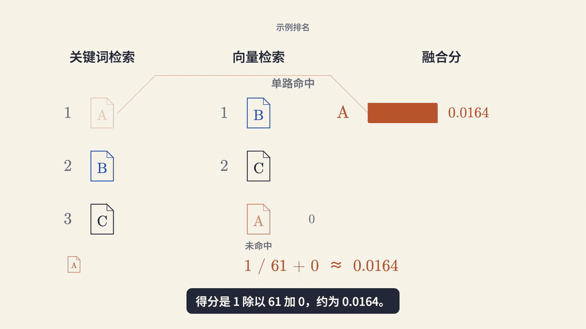

# one-minute-remotion

**Vibe 知识大赏：把一个知识点，做成一条 1 至 2 分钟的中文科普视频。**

给 Agent 一个主题，或一份已经写好的稿子，按阶段完成写稿、配音、分镜、动画、字幕与 MP4。适合数理化生的课本知识，也适合 RRF、RAG、ReAct 等 AI 概念。画面用连续动作讲清“为什么”，文稿、配音、场景和时间轴都能继续修改。

[安装 Skill](#安装) · [看实际案例](#四个主题看实际效果) · [下载导入包](https://github.com/itwanger/one-minute-remotion/releases/latest) · [制作流程](references/runtime.md)

## 四个主题，看实际效果

以下素材来自已经制作的项目。三个 GIF 是成片中截取的连续片段，原速、无声；点击它们可打开完整有声 MP4。勾股定理展示已确认的预览成帧，尚未导出有声成片。

| 勾股定理 · 拼图证明 | 牛顿第一定律 · 理想斜面 |
| --- | --- |
| [](references/approved-memphis.md) | [](https://github.com/itwanger/one-minute-remotion/releases/download/v0.2.1/newton-first-law-demo.mp4) |
| 两套画风：暖米几何 / 孟菲斯；**预览案例** | 孟菲斯版；**84.07秒，完整旁白与字幕** |
| **阿基米德原理 · 排水与浮力** | **欧姆定律 · 电压与电流** |
| [](https://github.com/itwanger/one-minute-remotion/releases/download/v0.2.1/archimedes-principle-demo.mp4) | [](https://github.com/itwanger/one-minute-remotion/releases/download/v0.2.1/ohms-law-demo.mp4) |
| 孟菲斯版；**92.23秒，完整旁白与字幕** | 孟菲斯版；**97.57秒，完整旁白与字幕** |

[牛顿第一定律完整视频](https://github.com/itwanger/one-minute-remotion/releases/download/v0.2.1/newton-first-law-demo.mp4) · [阿基米德原理完整视频](https://github.com/itwanger/one-minute-remotion/releases/download/v0.2.1/archimedes-principle-demo.mp4) · [欧姆定律完整视频](https://github.com/itwanger/one-minute-remotion/releases/download/v0.2.1/ohms-law-demo.mp4)

这些案例分别让面积变成可搬动的拼图、让斜面变化推动推理、让浸入体积对应浮力、让电池接入对应电流读数。公式和参数贴着对象，旁白负责解释，动作负责呈现因果。

完整视频均为1920×1080、30fps，保留二哥旁白供观看；安装 Skill 后使用你自己选定的声音或音频。成片文件按原文件发布，未为展示重新剪稿、加速或重配音。[素材来源、时码与哈希](docs/media/science/provenance.json)可供核对。

### 两套画风，一套制作流程

| 暖米几何 | 孟菲斯 |
| --- | --- |
|  |  |
| 暖米底、语义色、清楚的几何关系 | 粉彩色面、靛色轮廓、完整主体开场 |

两套画风都使用手机观看字号、连续对象和语义字幕。标签框、描边、阴影和公式上标都计入避让检查。[视觉规范](references/visual-style.md) · [孟菲斯规范](references/style-memphis.md) · [勾股定理案例](references/approved-memphis.md)

<details>
<summary>AI 概念案例：RRF 排名融合（66.13秒）</summary>

两路排名变成贡献条，再合并并重排，同一份文档始终保留名字与颜色。以下片段来自早期60秒目标的完整视频，实际66.13秒，原速无声。

[](https://github.com/itwanger/one-minute-remotion/releases/download/v0.1.1/rrf-demo.mp4)

[完整有声视频](https://github.com/itwanger/one-minute-remotion/releases/download/v0.1.1/rrf-demo.mp4) · [原始文稿](examples/rrf.md) · [完整案例与分镜](docs/rrf-case.md)

</details>

## 安装

把下面这句话发给支持 Skills 的 Agent：

> 请从 https://github.com/itwanger/one-minute-remotion 安装 one-minute-remotion Skill 到当前 Agent，读完 SKILL.md 后告诉我安装结果，先不要制作视频。

也可以通过 [Vercel Skills CLI](https://github.com/vercel-labs/skills) 安装：

```bash
npx skills add itwanger/one-minute-remotion -g

# 指定 Agent
npx skills add itwanger/one-minute-remotion -g -a claude-code -y
npx skills add itwanger/one-minute-remotion -g -a codex -y
```

使用界面导入的 Agent，可从 [Releases](https://github.com/itwanger/one-minute-remotion/releases/latest) 下载 `one-minute-remotion.zip`。其他环境按宿主的标准 `SKILL.md` 加载方式安装完整目录，不能只复制一个 SKILL.md；支持读取文件也不等于宿主支持原生安装。

这里是 Skill 的安装、规则、工具和发行主仓库。[VibeScience](https://github.com/itwanger/vibe-science)提供公开无声画面工程，作为配套示范，使用本 Skill 不需要先安装它。

## 从一个主题开始

先只写稿：

```text
用 one-minute-remotion，做一期“阿基米德原理”。
面向刚接触浮力的初中生，用金属块入水的同一个例子讲清排水体积与浮力。
先写文字稿，保存到 docs/src/ai/one-minute/archimedes-principle.md。
```

已有稿件就沿用真源：

```text
文字稿已经保存到 docs/src/ai/one-minute/archimedes-principle.md，下一步。
```

这时进入配音阶段，生成或导入完整音频、测量实际时长，交付试听后停下。现成文稿逐字保留；超过目标时长，只报告实际时长与超出秒数，不擅自删字或加速。[勾股定理文稿范例](examples/pythagorean-theorem.md) · [写稿规范](references/narration.md)

| 当前进度 | 接下来完成什么 | 停在哪里 |
| --- | --- | --- |
| 文字稿已保存 | 固定文字与声音，生成或导入配音，核对实际时长 | 交付完整音频，等待试听 |
| 配音已确认 | 按真实音频设计分镜，约30秒一章 | 等待分镜确认 |
| 分镜已确认 | 只实现当前章，交付带原旁白与字幕的 Studio 预览 | 本章确认后才做下一章 |
| 全部章节已通过 | 串联整片，检查衔接、声音与字幕 | 等待整片确认 |
| 整片已确认，且明确要求导出 | 导出 MP4，核对解码、音画同步与实际播放 | 交付成片与工程 |

“下一步”只推进一个阶段，动画阶段只推进当前章。只有明确要求跳过确认、连续完成指定范围，才执行该范围；普通“下一步”不会自动导出。具体规则见[逐章有声预览](references/chapter-preview.md)。

修改时直接说清画面问题，例如：

```text
电流变化请用电荷移动速度来表现，保持电荷间距。
保留文稿、配音和已确认的其他章节，只修改这一段，再给我有声预览。
```

## 项目按主题、工具与版本归档

```text
你的工作目录/
├── docs/src/ai/one-minute/                 文字稿
└── videos/one-minute/
    ├── pythagorean-theorem/codex/memphis/  主题 / 工具 / 版本
    │   ├── project.json、PROGRESS.md
    │   ├── audio/、build/、assets/
    │   ├── remotion/、preview/
    │   └── output/                        正式成片
    ├── ohms-law/workbuddy/reviewed/
    ├── shared/                            固定版本动画库、字体、基础色板
    └── _archive/                          历史试作（可选）
```

接力制作保留一份工程，记录制作、返修、导出分别由谁完成；工具来源不明用 `unattributed`，不按画风猜作者。公共组件集中复用，各期的配音、时间轴、场景和审片记录留在对应版本中。`script/one-minute/` 也支持同样结构；已有独立工程可继续使用。

## 运行环境与声音

写稿、分镜由当前 Agent 完成。真正制作需要本地命令执行能力、Node.js 22.20+、Python 3.10+、FFmpeg/ffprobe，以及可访问 Studio 的浏览器。包内带固定版本的 Remotion 模板，npm 依赖安装在项目中；首次渲染可能下载 Chromium。

声音可以导入你提供的完整意群 WAV/MP3，也可以使用你已有的 TTS 配置。包内提供可选的火山单向 SSE 适配器，其他服务可先生成音频再导入。安装 Skill 不会自动开通服务、调用付费 TTS 或下载 ASR 模型。

演示视频含二哥旁白供观看；运行包不分发可调用的二哥音色配置、克隆模型、原始录音、头像或凭据。使用者选定的声音和原语速优先。默认目标120秒，已有60秒锁定目标保持不变。[命令与配置](references/runtime.md)

## 仓库内容与贡献

```text
SKILL.md                         Agent 工作入口与阶段规则
references/                      写稿、动画、画风、逐章审片与运行流程
scripts/                         文字锁定、共享资源安装、Studio 后台启动
assets/runtime/shared/           独立模板、音频与导出工具
assets/styles/                   基础色板
assets/huashu/                   随包第三方动画代码与字体（含许可及哈希）
examples/                        完整文字稿范例
docs/media/                      真实案例成帧与动态片段
tests/                           打包、声音保护、时长及共享资源检查
```

欢迎通过 [Issues](https://github.com/itwanger/one-minute-remotion/issues)反馈复现步骤、画面问题或新的知识点案例。提交场景改进时说明原文、动作、音频锚点和实际检查范围；截图说明版式，动态播放与听感仍需要实际核对。

开发检查与打包：

```bash
python3 -m unittest discover -s tests -v
python3 scripts/package_skill.py --output dist/one-minute-remotion.zip
```

同步范围与发行约定见[开源维护说明](docs/maintaining.md)。

## 许可

本项目自有内容采用 [MIT](LICENSE)。随包第三方代码与字体保留各自的许可证和来源记录，详见[第三方说明](THIRD_PARTY_NOTICES.md)。Remotion 等依赖按各自许可使用，本仓库的 MIT 许可不替代它们。
