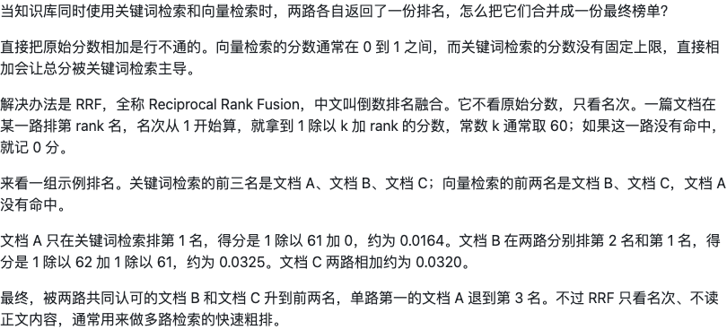
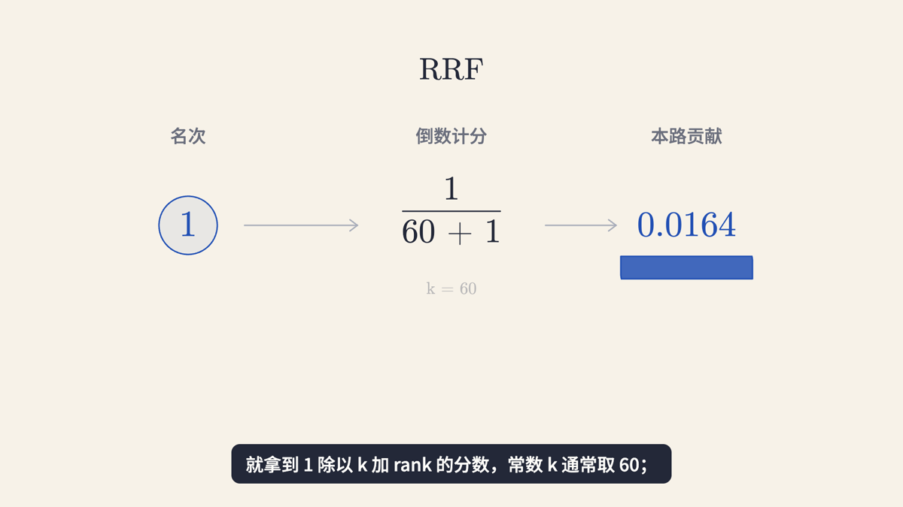
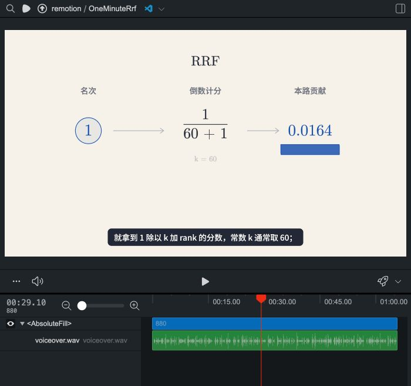
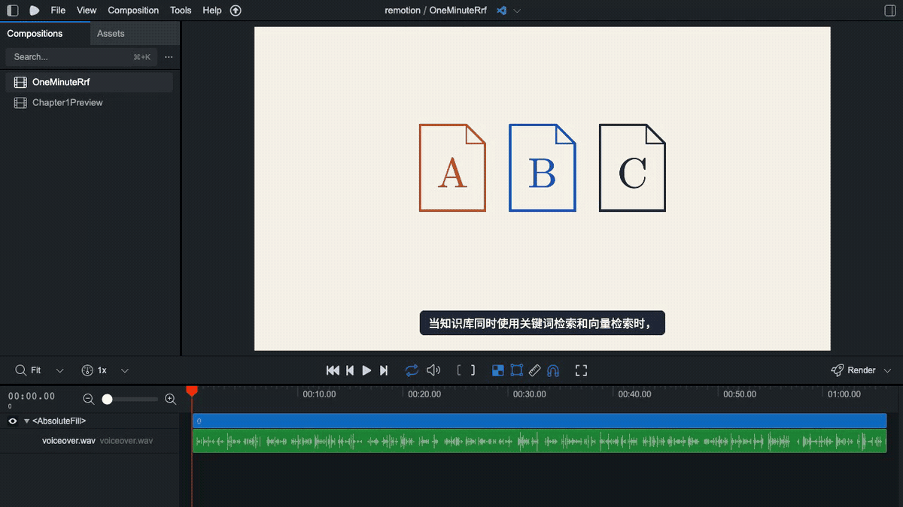
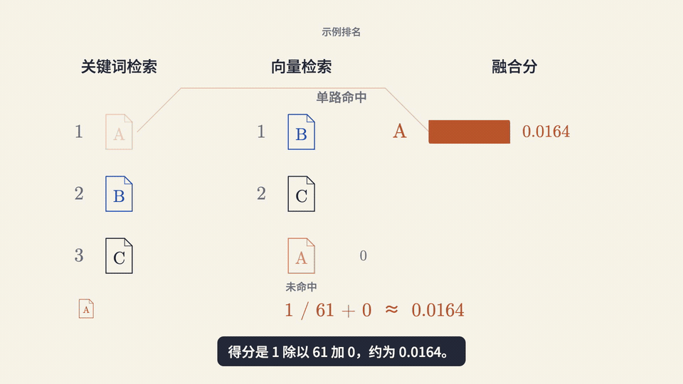
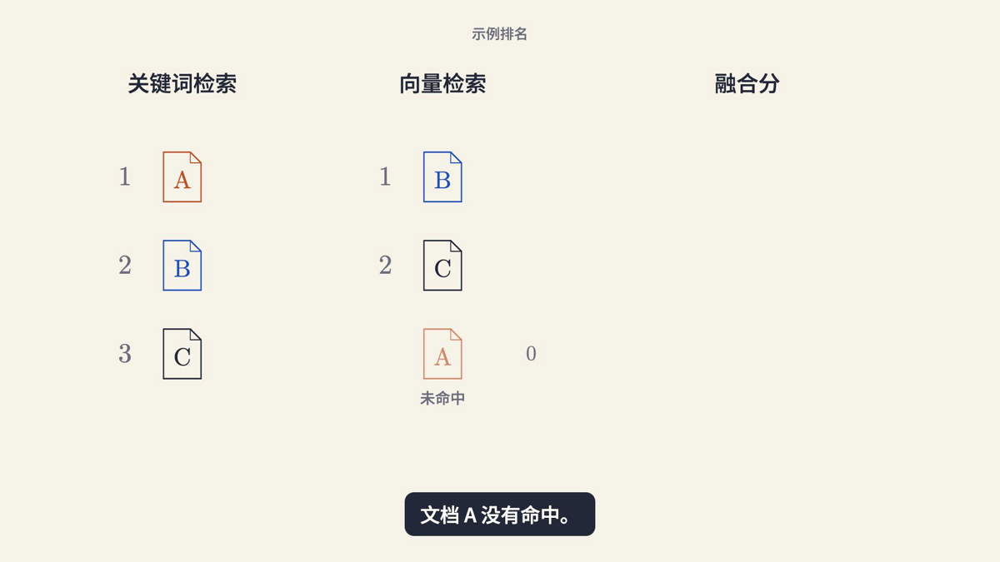
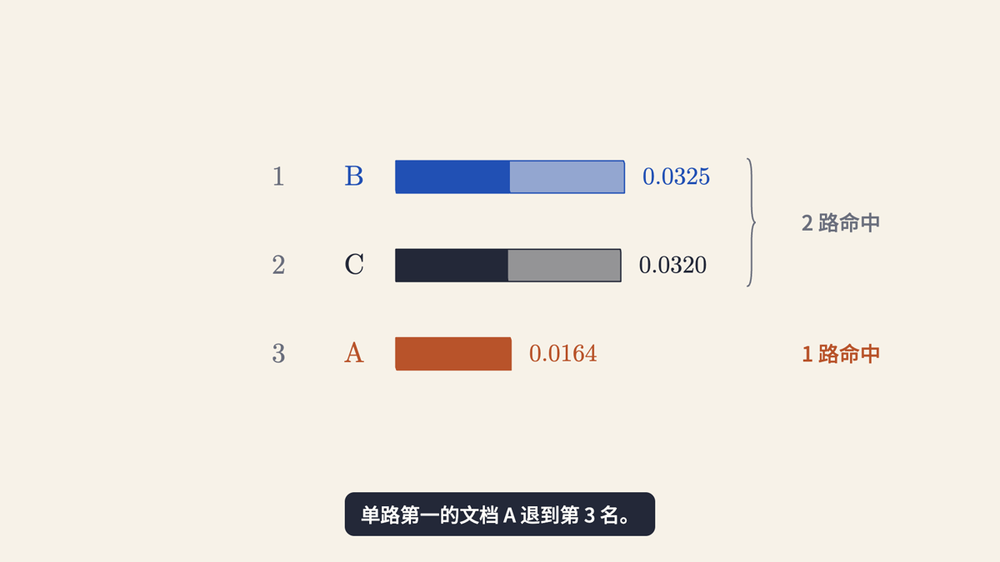

# RRF：从文稿到一条完整科普视频

这是本 Skill 从原有视频实践中提炼出的真实案例。展示文件沿用已经保存的 layout-v5 完整视频，没有重新配音或改稿；示例不代表刚刚安装公开版即可获得作者的私人音色。

[完整文字稿](../examples/rrf.md) · [观看 / 下载完整 MP4](https://github.com/itwanger/one-minute-remotion/releases/download/v0.1.1/rrf-demo.mp4)

## 文字与声音

一组 A/B/C 文档贯穿全文。原文、标点、完整旁白保留，音频66.130167秒，画面1984帧/30fps，即66.133333秒。音频超出60秒目标，因此如实展示实际时长，不删稿、不加速。字幕分成26组可读短句，保留原文。

制作时文字锁定、声音配置与实际语音时间轴在项目内维护；公开案例只提供文稿、画面和最终视频，不提供私人配置或干声。

## 实际分镜

| 帧范围（30fps） | 对象与动作 | 动画实现 |
| --- | --- | --- |
| 0–192 | 同一组 A/B/C 分到两路排名，右侧 A 未命中 | `DG.drawPartial` 描路径，同色同名保留身份 |
| 192–477 | 同一文档的不同分数尺度；0.92与16仅作教学示意 | 数值条与轴刻度共同变换量程 |
| 477–620 | 写出 RRF、英文及中文名 | `DG.write`，保留阅读停留 |
| 620–970 | 名次 → 倒数计分 → 本路贡献；k=60靠近公式，未命中贡献0另成分支 | `DG.circlePts / rectPts / morph / shape / math` |
| 970–1243 | 展示同一组示例排名；向量侧 A 保留文档身份并标未命中 | 固定文档颜色，不给未命中项虚构名次 |
| 1243–1672 | A 的单路贡献、B/C 的两路贡献分别汇到自己的行 | `DG.morph / drawPartial / flash`，条宽从真实贡献计算 |
| 1672–1847 | B/C/A 连续换位，A先侧移再下移归列 | 同一名字和贡献条一起移动，`CAM.track` 回到全貌 |
| 1847–1984 | 保留最终榜单，交代只看名次与快速粗排的边界 | 固定结果，不加营销尾段 |

## 画面风格

暖米底 `#f7f2e8`、深色正文 `#232838`、蓝色 `#2150b4`、铁锈橙 `#b8532a`。A 为铁锈橙、B 为蓝、C 为深色，同一对象跨场景保留身份。细轮廓、公式与连续形变来自花叔的图解语法，色板与字幕沿用二哥风格。

公式和数值留在主画面，完整解释交给旁白与字幕。读公式时镜头稳定；推近只服务于计算细节，最后拉回完整榜单。字幕在独立底部安全区，不随世界相机缩放。

## 实际录屏与成片片段

下面是这次新增录制的真实 Studio 页面播放，已剪去开头等待。没有重绘界面或伪造 Agent 执行过程；录屏 GIF 无声。

下面是从完整 MP4 连续截取的46.8–62.3秒，正常速度、无声。它展示两路贡献合并和最终重排；完整66.13秒版本含旁白与字幕。

## 实作修正

- 规则段不再散放名次、公式和参数，改为一条有方向的成组计算流程；例外分支与主流程对齐。
- 未命中 A 仍保留文档轮廓、名称与身份色，弱化并另标状态，贡献0不表示它排第三。
- 最终右侧括号开口朝左归纳 B/C，两路命中说明位于右侧，不包住 A。
- 对象形变经过公式下方，排序先侧移再换行；检查中间状态，不只看两个端点。

## 文件核对

公开展示 MP4 与已经保存的完整预览逐字节一致，未重编码旁白或重新生成配音。

- H.264/AAC，1920×1080，30fps，1984帧，66.133333秒。
- 文件大小：4,341,421字节。
- SHA-256：`014bdf1b9397d51f7059c7dbc62f4f428e2b823d89b3d084ed8426f91fe7483f`。
- 全文件解码通过，6个有声窗口与原配音波形相关度均高于0.99997。该检查验证文件与同步，不证明每个术语读音或教学效果已经验收。

这里展示的是实际视频产物及其制作方法，不编造写稿模型调用、生成过程录屏或未经执行的检查。库、字体与色板来源沿用[第三方说明](../THIRD_PARTY_NOTICES.md)。
